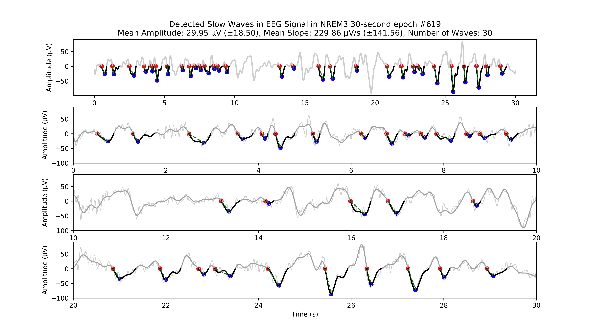
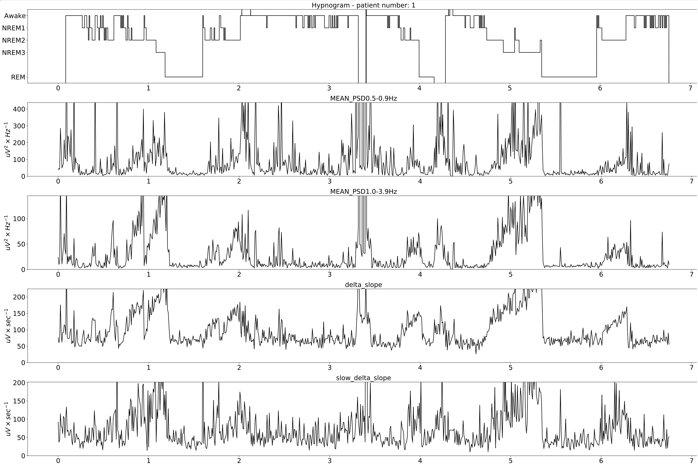

EEG Wave Detection and Analysis
########################################################

Project: EEG Slow Wave Detection and Analysis
""""""""""""""""""""""""""""""""""""""""""""""""""""""""""""""""""""""""""""

This project was published in the following paper:
 |
 | Carvalho DZ, Kremen V, Mivalt F, St Louis EK, McCarter SJ, Bukartyk J, Przybelski SA, Kamykowski MG, Spychalla AJ, Machulda MM, Boeve BF, Petersen RC, Jack CR Jr, Lowe VJ, Graff-Radford J, Worrell GA, Somers VK, Varga AW, Vemuri P. Non-rapid eye movement sleep slow-wave activity features are associated with amyloid accumulation in older adults with obstructive sleep apnoea. Brain Commun. 2024 Oct 7;6(5):fcae354. doi: `10.1093/braincomms/fcae354 <https://doi.org/10.1093/braincomms/fcae354>`_. PMID: 39429245; PMCID: PMC11487750.
 |

The slow-wave detection used in this project is part of the
`BrainMaze EEG <https://bnelair.github.io/brainmaze-eeg/>`_ package
(``pip install brainmaze-eeg``) as the ``WaveDetector`` class. The full project
page, including the study configurations, the numbers the demo reproduces, and
the original analysis script of the study (a historical listing that needs the
legacy BEST toolbox and does not run against brainmaze-eeg), is maintained with
the package documentation, so that it stays in sync with each release:

- **Project page (package docs)**: https://bnelair.github.io/brainmaze-eeg/project_wave_detector.html
- **WaveDetector API, algorithm and outputs**: https://bnelair.github.io/brainmaze-eeg/features.wave_detector.html
- **Runnable example with sample data** (``example_one_file.py``, 6.8 h recording): https://github.com/bnelair/brainmaze-eeg/tree/main/demo/eeg_wave_detection

.. note::

   Earlier versions of this page listed the original study script, which
   imported ``best`` (the BEST toolbox) and an unpublished
   ``SlowWaveDetector.py`` (``SlowWaveDetect``). That code does not run against
   brainmaze-eeg. Use ``WaveDetector`` as shown below (brainmaze-eeg 3.0.0).

Quick start with brainmaze-eeg 3.0.0 (taken from the package's project page,
where both configurations are explained)::

    from brainmaze_eeg.features.wave_detector import WaveDetector

    # x: Fz-(A1+A2)/2 in uV; broadband: the same signal band-passed 0.5-35 Hz

    # (1) slow-oscillation (0.5-0.9 Hz) downslope as computed since v1.0.0
    #     (default trough='refine'): detect on the band, measure on the broadband trace
    so = WaveDetector(fs=fs, fband=(0.5, 0.9), segm_size=30,
                      slope='downslope', amplitude_threshold=5)
    values, names = so(x, measure_on=broadband)   # per 30 s segment; e.g. WAVE_SLOPE_MEAN in uV/s

    # (2) the Methods text of the paper (trough='paper')
    so_paper = WaveDetector(fs=fs, fband=(0.5, 0.9), segm_size=30,
                            amplitude_threshold=5, trough='paper')
    values, names = so_paper(x)

Acknowledgement
"""""""""""""""""""""""""""
 |
 | F. Mivalt et V. Kremen et al., “Electrical brain stimulation and continuous behavioral state tracking in ambulatory humans,” J. Neural Eng., vol. 19, no. 1, p. 016019, Feb. 2022, doi: 10.1088/1741-2552/ac4bfd.
 |
 | F. Mivalt et V. Sladky et al., “Automated sleep classification with chronic neural implants in freely behaving canines,” J. Neural Eng., vol. 20, no. 4, p. 046025, Aug. 2023, doi: 10.1088/1741-2552/aced21.
 |
 | Gerla, V., Kremen, V., Macas, M., Dudysova, D., Mladek, A., Sos, P., & Lhotska, L. (2019). Iterative expert-in-the-loop classification of sleep PSG recordings using a hierarchical clustering. Journal of Neuroscience Methods, 317(February), 61?70. https://doi.org/10.1016/j.jneumeth.2019.01.013
 |
 | Kremen, V., Brinkmann, B. H., Van Gompel, J. J., Stead, S. (Matt) M., St Louis, E. K., & Worrell, G. A. (2018). Automated Unsupervised Behavioral State Classification using Intracranial Electrophysiology. Journal of Neural Engineering. https://doi.org/10.1088/1741-2552/aae5ab
 |

Version
""""""""""""""""""
Original study code: version 1.0 (2024-06-01) by V. Kremen (Kremen.Vaclav@mayo.edu).

Examples
""""""""""""""""""
Example of individual slow wave detections.

Extracted features for the whole night.

